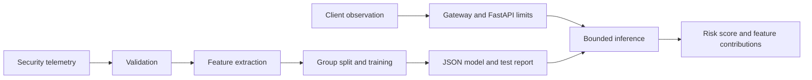

# RansomwareBehaviorDetector

Machine-learning detection of ransomware-like filesystem behavior from safe process telemetry. This standalone project provides reproducible class-weighted training, local inference, a bounded FastAPI service, and operational documentation.

## Overview

The detector scores process-level time windows for ransomware-like file modification, rename, entropy-change, and extension-change patterns using safe metadata only. Predictions are decision support and must be reviewed in context.

## Features

- Explicit Pydantic telemetry schema with bounded finite numeric values.
- Deterministic process-window feature extraction from inert telemetry.
- Group-disjoint train/validation/test partitions and balanced training weights.
- Validation-selected threshold, untouched test metrics, strict JSON artifact, and local feature contributions.
- Bounded API, optional production API key, structured logs, Prometheus metrics, Docker, and CI.

## Architecture



## How It Works

Supply a local CSV with the documented numeric fields, `group_id`, and binary `label` (0 for benign, 1 for ransomware_like). Training validates rows, rejects label conflicts on identical feature vectors, deduplicates exact vectors, and keeps each group in only one partition. Scaling and class-weighted logistic regression fit on training rows only. The threshold is selected on validation F1; metrics are computed on untouched test rows. The service applies the saved feature order and parameters to one or more observations.

## Machine Learning Approach

Scikit-learn logistic regression with `class_weight="balanced"` and training-only standardization is the baseline. Model probability becomes a 0–100 risk score. Signed local contributions are standardized feature value times model coefficient; they explain the linear score but do not establish causality. Confidence may be miscalibrated under distribution shift.

## Dataset

The [MLRan behavioral dataset](https://github.com/faithfulco/mlran) is a research starting point; its published feature schema differs from this project's process-window schema. See `data/README.md` for source terms and the exact inert JSONL event format accepted by `scripts/prepare_telemetry.py`. No binaries or data are downloaded, bundled, or executed. Use authorized records with source-defined labels or reviewed analyst outcomes. Synthetic data from `scripts/generate_test_data.py` is only a smoke-test fixture.

## Features Used

Raw and engineered fields: window_seconds, file_modify_count, file_rename_count, file_delete_count, extension_change_count, high_entropy_write_count, mean_entropy_delta, unique_directories_touched, process_spawn_count, bytes_written, protected_file_touch_count, modifications_per_minute, renames_per_minute, extension_change_ratio, high_entropy_write_ratio, bytes_written_log. The local preparation script aggregates safe event metadata; bounds and count consistency checks are in `src/ransomware_behavior_detector/features.py`. The API accepts summaries, not file paths, contents, or executable samples.

## Model Training

`configs/training.json` controls random seed, split fractions, regularization, iteration cap, and dataset size limits. Training writes `models/model.json` and `models/model.metadata.json`, both ignored by Git. Metadata contains source SHA-256, hyperparameters, split counts, threshold selection, held-out metrics, and model version.

## Model Evaluation

Group-disjoint splitting limits repeated-entity leakage; exact duplicate features cannot cross partitions. The test class distribution is not artificially balanced. Validate on a later time period and the target environment before deployment, and inspect per-group false positives.

## Metrics

The held-out report includes precision, recall, F1, ROC-AUC, PR-AUC, false-positive rate, false-negative rate, confusion matrix, and class support. No benchmark score is claimed until trained on source data. `/metrics` exposes aggregate request, prediction, error, and latency measurements.

## API

`GET /health`, `GET /ready`, `GET /version`, `GET /metrics`, `POST /api/v1/predict`, and `POST /api/v1/batch-predict`. Requests contain `observation` or `observations`; responses contain `prediction`, `confidence`, `risk_score`, `model_version`, and five local feature contributions. `/ready` returns 503 without a valid model. Production requires a strong `API_KEY`; predictions and metrics then require `X-API-Key`.

## Installation

```bash
git clone https://github.com/Arjunren/RansomwareBehaviorDetector.git
cd RansomwareBehaviorDetector
python -m venv .venv
# Activate .venv using your shell's standard command.
python -m pip install -e ".[dev]"
pre-commit install
```

Python 3.12+ is required. No sensitive dataset or trained model is needed to run the tests.

## Configuration

Copy `.env.example` to `.env` and edit the API key, model path, and limits. Keep `.env`, data, and model artifacts in controlled storage. Training hyperparameters live in `configs/training.json`.

## Environment Variables

| Variable | Purpose | Default |
| --- | --- | --- |
| `APP_ENV` | `development`, `test`, or `production` | `development` |
| `LOG_LEVEL` | Structured log level | `INFO` |
| `MODEL_PATH` | JSON model path | `models/model.json` |
| `API_HOST`, `API_PORT` | Local bind values | `127.0.0.1`, `8000` |
| `API_KEY` | Shared inference/metrics key | empty in development |
| `MAX_BATCH_SIZE` | Maximum records per batch | `100` |
| `MAX_REQUEST_BYTES` | JSON body cap | `1048576` |
| `MAX_CONCURRENT_INFERENCE` | Worker/admission cap | `4` |
| `INFERENCE_TIMEOUT_SECONDS` | Queue and response timeout | `2` |

## Running Locally

Prepare authorized, labeled telemetry JSONL as specified in `data/README.md`, convert to training CSV, train, then run `make serve` or `uvicorn ransomware_behavior_detector.api:app --host 127.0.0.1 --port 8000`. For a fresh-clone smoke test, run `python scripts/generate_test_data.py`, then train on `data/processed/synthetic.csv`. Synthetic metrics must not be used as operational evidence.

## Running with Docker

Train before building to include `models/model.json`. Set a strong key and `APP_ENV=production` in `.env`, then run `docker compose build && docker compose up`. The image runs non-root with a health check; Compose binds loopback, uses a read-only filesystem, drops capabilities, and caps CPU/memory/processes. Add gateway TLS, per-client identity, authorization, and rate limits for shared exposure.

## Training the Model

```bash
python scripts/generate_test_data.py
ransomware-behavior-detector train --dataset data/processed/synthetic.csv --model models/model.json --config configs/training.json --version 1.0.0
```

Replace the synthetic CSV with reviewed source data before measuring quality or deployment. Assign a new semantic version after retraining or changing feature definitions.

## Running Inference

```bash
ransomware-behavior-detector predict --observation examples/observation.json
ransomware-behavior-detector evaluate
```

## API Examples

```bash
curl -H 'Content-Type: application/json' -H 'X-API-Key: replace-with-configured-key' \
  -d '{"observation":{"window_seconds":300,"file_modify_count":15,"file_rename_count":2,"file_delete_count":1,"extension_change_count":0,"high_entropy_write_count":1,"mean_entropy_delta":0.1,"unique_directories_touched":2,"process_spawn_count":1,"bytes_written":100000,"protected_file_touch_count":0}}' http://127.0.0.1:8000/api/v1/predict
```

Batch inference accepts `{"observations":[{...},{...}]}` and returns `{"predictions":[...]}`. Values depend on the trained model.

## Testing

Run `make lint`, `make typecheck`, `make test`, and `make security`. Automated checks cover feature extraction, grouped splitting, training round trip, model loading, API health, authentication, malformed requests, oversized bodies/batches, and corrupted artifacts. Tests use synthetic data and mock or avoid external services.

## Security

Telemetry, datasets, and model artifacts are untrusted. Pydantic validates explicit bounded fields; inference has body, batch, queue, concurrency, and timeout limits. JSON artifacts have fixed feature order, finite numeric values, size cap, and SHA-256 checksum; no pickle is loaded. Logs exclude raw observations, credentials, and payloads. See `docs/security.md` for threat model and residual risks.

## Project Structure

`src/ransomware_behavior_detector/` contains schema, features, training, artifacts, settings, CLI, and API. `configs/` holds training settings; `data/` and `models/` hold ignored inputs/artifacts; `scripts/` has synthetic smoke fixtures; `tests/` separates unit, integration, and security checks; `docs/` has architecture, security, and model card; `.github/workflows/ci.yml` runs quality gates.

## Monitoring and Observability

Scrape authenticated `/metrics` with Prometheus and display request/error/latency trends in Grafana. Review prediction mix, drift, and analyst-confirmed outcomes. Avoid high-cardinality identifiers and sensitive values in logs or metric labels.

## Limitations

Backup, migration, indexing, and bulk software updates can resemble rapid file operations; low-rate or selective attacks can evade short windows. The model is a baseline and its probabilities are not guaranteed to be calibrated. Grouped random evaluation does not replace prospective time-based validation. Shared-key mode is not tenant-level authorization.

## Future Improvements

Add process-lineage context, time-sliced evaluation, calibration, and approved response integrations with explicit human review. Add time-sliced evaluation, calibration, reviewed feedback, signed model provenance, and deployment-specific quotas.

## Responsible Use

Do not terminate processes, quarantine files, or roll back data automatically from this score alone. Keep analysts in the approval loop for high-impact actions and respect source data terms and privacy policies.

## Contributing

Submit focused issues or pull requests with reproducible synthetic fixtures. Run all quality gates and do not commit secrets, sensitive telemetry, large datasets, or trained models.

## License

Project code is MIT licensed. Source data has separate terms documented in `data/README.md`.
