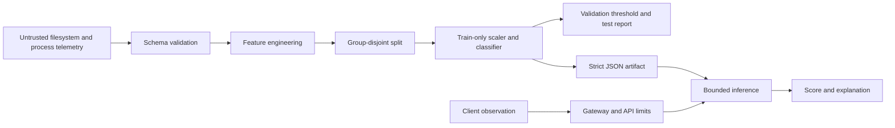

# Architecture

## Components and data flow

The local preparation script aggregates precomputed filesystem/process metadata by process lineage and time window; it never reads, modifies, or executes files. The training CLI loads normalized CSV, validates every field and label, rejects conflicting duplicates, and keeps group IDs exclusive to a partition. Feature extraction is deterministic. The scaler and class-weighted logistic regression fit on training only; a validation threshold is selected before untouched test evaluation. The CLI writes JSON model and metadata. FastAPI validates requests, loads the artifact, and performs bounded inference.

## Trust boundaries

CSV files, HTTP bodies and headers, and model artifacts are untrusted. The API accepts numeric summaries only. A gateway supplies TLS, client identity, authorization, and per-client rate limits. Protect approved model artifacts in trusted storage; an embedded checksum detects corruption but is not a signature.

## Model lifecycle and deployment

Version the artifact and feature schema together. Review dataset lineage, split composition, held-out metrics, drift, and analyst feedback before promotion. Keep data and model artifacts out of Git. Docker serves a pre-trained artifact as non-root with read-only filesystem and resource caps. Prometheus/Grafana monitor aggregate health without sensitive labels.
